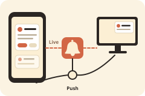

  

# Notification tester

  

Didn't work? Create a Studio workspace and paste this to your agent:
` /use-template https://github.com/boweiliu/notification-tester-template`

## Why you care

Test phone and desktop Web Push and Live notifications, rich actions, browser support and delivery diagnostics

Whether a notification reaches a phone depends on things you cannot see from the sending side: the browser, the operating system's permission, Do Not Disturb, and the browser vendor's push service in the middle. This gives you a page to sign a device up, a page to send it a test, and a receipt trail that shows how far each message got.

## How to use it

1. Share the app from Studio so it has an HTTPS address, then open that link directly on the device you want to test (not inside the Studio window). Sign in, add it to the Home Screen where your phone needs that, allow notifications and register the device. The page shows its own version and its service worker's version.
2. Open `/send` on the same address, from another tab or another device. Pick the device, a channel (**Push**, **Live** or **Both**) and a style. Start with Plain.
3. Read the result on the sender page: the push service's answer, whether the device reported showing it, and any button press or reply. Each send links to its raw record at `/sends/<send_id>/raw`.
4. Try the other styles (Yes / No, quick replies, reply page, inline reply, big picture, sticky with buzz, updating, app badge). Browsers silently ignore options they do not support, so the page shows what actually happened rather than what was requested.
5. Chat copies: once the app is registered, every notification the agent sends you in chat is also copied to your registered devices. Turn that on or off, and pick the channel, on the sender page.

Push can arrive after the page is closed. Live needs an open, connected page. A successful answer from a push service means it accepted the message, not that anyone saw it. The `docs/` folder inside the app covers installation, delivery architecture and the API, browser behaviour and diagnosis, and backup and upgrades; `/api/schema` serves the machine-readable API.

## Ideas for making it yours

- Add your other devices (a second phone, a work laptop, a different browser) and compare how each handles the same style.
- Read the replies and button answers back through the app's API and have an agent act on them, for example approve or snooze a task from a notification.
- Run a daily test send from a scheduled job and alert yourself when a device stops receiving Push.
- Add a style of your own to the style list, such as a Snooze button or a longer message, and see which browsers keep it.
- Test the platforms the first version did not cover (iOS Home Screen apps and Android Chrome) and record what you find in the browser guide.

## What this is

This repository is a published **Imbue Studio template**: a clean, bootable
snapshot of what an agent built, ready to adapt into your own. It is NOT the
generic workspace template -- it is this specific project.

[`template.md`](template.md) is the full manifest -- what it is, how it
works, what it needs to run, and what to adapt -- with the
machine-readable half (recipe, requirements, and the environment it needs
installed) in [`template.toml`](template.toml).
